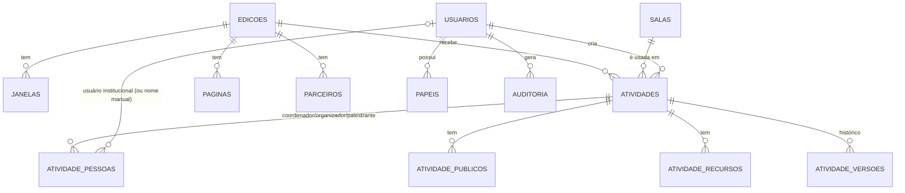

# Modelo de dados (PostgreSQL) — esquema completo em `db/schema.sql`

Compartilhado entre edições: `usuarios`, `papeis`, `salas`, `opcoes`. Por edição: `edicoes`, `janelas`, `atividades` (e filhas), `paginas`, `parceiros`. Toda alteração de atividade grava um snapshot em `atividade_versoes`; ações relevantes vão para `auditoria`.
